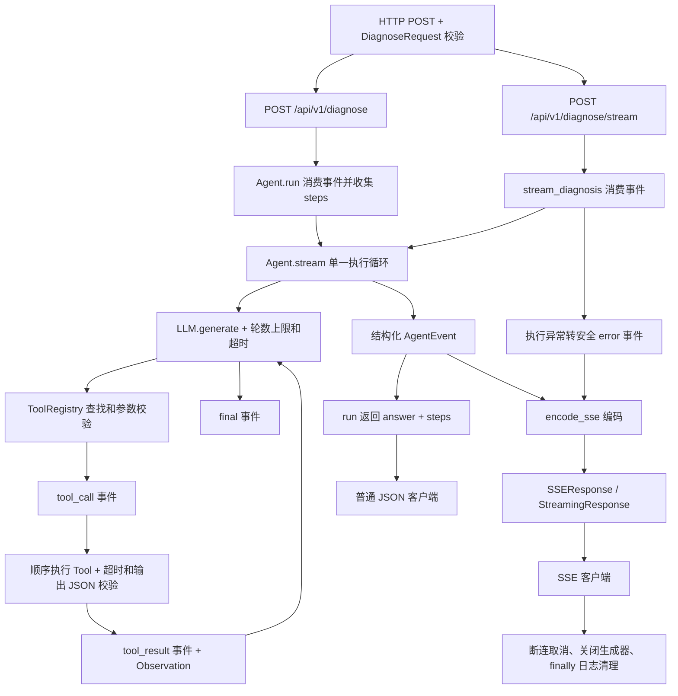
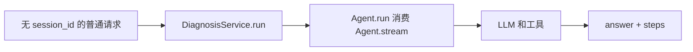
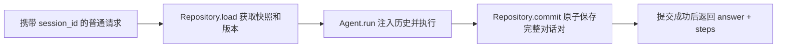
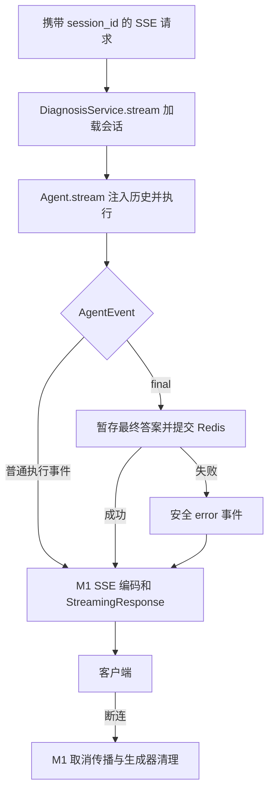

# OpsPilot

**OpsPilot — Enterprise AI SRE & Incident Diagnosis Agent**

当前版本 **V0.2-M2（Redis Conversation Session）**，保留 M1 SSE 并新增可选的 Redis 多轮对话。
这是用于学习和扩展的单 Agent 运维诊断后端基础，不是可直接上线的生产运维平台。
它以 FastAPI、异步 Python、可替换的 LLM 接口、手写 Agent Loop 和工具注册表完成一次完整诊断。
默认 `LLM_MODE=mock`，不需要 API Key，也不访问真实 MySQL、Redis 或生产服务器。

## 当前能做什么

- 接收故障描述，经过模型选工具、执行、Observation 回传、多轮调用，返回最终诊断。
- 提供三个只读 Mock Tools；模型可一次返回多个调用，应用按顺序执行。
- 支持 MockLLM 和 OpenAI-compatible Chat Completions 两种模式。
- 提供轮数上限、模型/工具超时、参数校验、错误 Observation、结构化日志和自动化测试。
- 支持普通 JSON 诊断和 POST SSE 诊断，两者复用同一套 Agent 执行逻辑。
- 可选 Redis Session：完整对话轮次、滑动 TTL、版本并发控制、提交成功后返回最终答案。
- `steps` 仅包含实际 Tool Call / Tool Result，不返回隐藏推理或中间模型文字。

## 架构与目录

```text
User
  │
  ▼
FastAPI
  │
  ▼
Agent Loop
  │
  ▼
LLM ◄──────────────────────────────┐
  │                               │
  ├── Final Answer ──► Final Diagnosis
  │                               │
  ▼                               │
Tool Call                         │
  │                               │
  ▼                               │
Tool Registry                     │
  ├── System Metrics              │
  ├── MySQL Diagnostics           │
  └── Redis Diagnostics           │
  │                               │
  ▼                               │
Observation ──────────────────────┘
```

```text
app/
├── main.py                 # 应用组装、生命周期、中间件、HTTP 错误映射
├── api/                    # /health、/api/v1/diagnose、/api/v1/diagnose/stream、sse.py
├── agent/                  # loop.py、events.py、schemas.py、prompts.py
├── session/               # 对话 Schema、Redis Repository、安全错误和存储脱敏
├── services/              # DiagnosisService 协调执行与会话提交
├── llm/                    # base.py、mock.py、openai_compatible.py
├── tools/                  # registry.py 和三个 Mock Tool
└── core/                   # config.py、logging.py
tests/                      # 全部离线测试，包括 HTTP 协议模拟
pyproject.toml              # 唯一 Python 依赖声明
.env.example                # 无 Secret 的配置样例
Dockerfile                  # 独立 Python 3.11 Runtime
LEARNING.md                 # 作者学习问答及代码定位
```

## Agent Loop

核心在 [`app/agent/loop.py`](app/agent/loop.py) 的 `Agent.stream()`；`Agent.run()` 消费同一事件流组装原有 JSON 响应，HTTP/SSE 编码留在 API 层。

1. 为每个请求创建独立 `messages` 和 `steps`，放入系统提示、可选的对话历史与当前用户描述。
2. 从注册表导出工具名称、描述和 Pydantic JSON Schema，传给 `BaseLLM.generate()`。
3. LLM 返回工具调用时，将 assistant 调用消息加入上下文。
4. 按名称查找工具，验证 JSON 参数，再 `await tool.execute(arguments)`。
5. 将成功或失败结果转换成 Observation，以 `role=tool` 和对应 `tool_call_id` 追加到上下文。
6. 再次调用 LLM，由它决定继续获取证据，还是输出最终答案。
7. 没有 Tool Call 且答案非空时正常结束；达到 `MAX_STEPS` 仍无答案则抛出 `AgentExecutionError`。

`MAX_STEPS=6` 指 **LLM 调用轮数**，不是 `steps` 事件数。一次工具执行产生两个事件。
订单慢场景正常需要 3 轮 LLM、2 次 Tool、4 个工具事件（SSE 另外包含 `agent_start` 和 `final`）。设置为 2 会在收集完两项证据后失败，
因为没有剩余轮次让 LLM 生成最终答案；上限不会被额外的“最后总结”调用绕过。
每轮最多接受 16 个 Tool Call，并对每次 LLM / Tool 执行设置超时。

## Tool Calling

工具描述告诉模型“有什么能力”，输入 schema 告诉模型“参数格式是什么”。
**由 LLM 选择工具并生成参数**，应用只允许执行注册的工具并校验参数；模型本身不会执行 Python。
Observation 是工具真正返回的证据，必须重新送给模型，才能让最终诊断引用结果或发现还缺什么。

真实适配器使用 Chat Completions 的 `tools`、assistant `tool_calls` 和 `tool_call_id` 协议。
JSON 参数在工具边界校验；坏 JSON 同样成为错误 Observation，不会执行工具。
参考：[OpenAI 官方 Function Calling 文档](https://developers.openai.com/api/docs/guides/function-calling)。

## Tool Registry

[`app/tools/registry.py`](app/tools/registry.py) 用字典保存 `name → Tool`，支持
`register(tool)`、`get(name)`、`list_tools()`。重复注册会报错，未知名称返回 `None`。
每个 Tool 提供 `name`、`description`、`input_schema` 和异步 `execute()`。

工具在 `app/main.py:build_registry()` 中注册。增加工具只需要实现接口并注册，
Agent Loop 不增加按工具名判断的分支。未来可写遵守同一接口的 MCP 适配器；V0.1 没有 MCP 实现。

## 当前三个 Mock Tools

**所有指标均为固定 Mock Data，不是机器实时状态或真实生产数据。切换真实 LLM 后，工具仍是 Mock。**

| 工具 | 模拟返回值 | 输入 |
|---|---|---|
| `get_system_metrics` | CPU 35.2%、内存 61.4%、Load 1.28 | `{}` |
| `get_mysql_slow_queries` | orders 查询 2310 ms，扫描 1700000 行，返回 18 行 | `{}` |
| `get_redis_metrics` | 内存 312 MB、命中率 0.96、连接 84、阻塞 0 | `{}` |

三个工具都使用 `EmptyInput`，拒绝任何额外参数。当前工具没有真正异步 IO，但以后访问
MySQL、Redis、Prometheus、HTTP API、日志系统属于 IO-bound 操作，统一 `async` 接口可保持调用链稳定。
仅把阻塞函数包进 `async def` 不会让它变为非阻塞；未来仍需要异步驱动或明确的线程池边界。

## MockLLM

[`app/llm/mock.py`](app/llm/mock.py) 根据最新 User 问题和其后的 Observation 确定下一步，无共享轮次计数。
订单故障确定性选择：系统指标 → MySQL 慢查询 → 最终答案；包含 `redis` 或“缓存”的描述会额外调用 Redis。
工具顺序属于 MockLLM 的模拟策略，Agent Loop 没有硬编码这些工具。

最终答案读取 Observation 中的 CPU、SQL 耗时和扫描行数；改变工具返回值会改变答案，
这由测试验证。工具失败时直接说明证据不足，不把失败当作正常指标。
它不是自然语言理解模型，不会对任意问题智能规划，适合验证编排、回归测试和以后做不依赖模型网络的基准测试。

## OpenAI-compatible Adapter 与配置

[`app/llm/base.py`](app/llm/base.py) 定义 `BaseLLM` 和内部消息类型；
[`app/llm/openai_compatible.py`](app/llm/openai_compatible.py) 用 `httpx.AsyncClient` 实现协议转换。
HTTP Client 由 FastAPI 生命周期创建和关闭；Agent 不依赖任何厂商 SDK。

配置样例在 [`.env.example`](.env.example)。默认不需要创建 `.env`。
如需真实模型，在本地安全配置以下变量，勿提交密钥：

```dotenv
LLM_MODE=openai
OPENAI_API_KEY=
OPENAI_BASE_URL=
OPENAI_MODEL=
```

上面三个空值必须填入供应商提供的实际值。`OPENAI_BASE_URL` 是 API 根地址，
包含供应商要求的 `/v1` 等路径，**不要包含 `/chat/completions`**，适配器会追加它。
Base URL 不允许用户名、密码、query 或 fragment。配置在应用启动时验证。
开发机可用 `.env`，已被 `.gitignore` 排除；镜像构建也会排除 `.env`。

| 环境变量 | 默认值 | 含义 |
|---|---|---|
| `LLM_MODE` | `mock` | `mock` 或 `openai` |
| `MAX_STEPS` | `6` | 每次诊断最多模型调用次数，允许 1–100 |
| `LLM_TIMEOUT_SECONDS` | `30` | 每次模型调用超时 |
| `TOOL_TIMEOUT_SECONDS` | `10` | 每次工具调用超时 |
| `OPENAI_API_KEY` | 空 | 真实模式必填，使用 SecretStr 保存 |
| `OPENAI_BASE_URL` | 空 | 真实模式必填 |
| `OPENAI_MODEL` | 空 | 真实模式必填 |

适配器支持标准文本和 function tool calling，丢弃 `reasoning` / `reasoning_content` 等字段。
模型服务的 HTTP 错误、超时、截断答案、空答案和无效响应会转换成业务错误。
不同供应商仍可能需要额外字段，尤其是要求回传专有 reasoning 字段的模型；V0.1 没有实现这些扩展。
本次没有使用真实 Key 调用供应商，兼容性通过 `httpx.MockTransport` 验证。

## Development Environment

```text
Windows Host
    ↓
WSL2 Ubuntu
    ↓
Conda
    ↓
opspilot environment
    ↓
Python 3.11
```

项目路径：`/home/wmx/project/opspilot`。只用 Conda 管理 Python 版本和环境隔离，
Python 包统一由 `pyproject.toml` + pip 管理，不创建 venv，不使用 Poetry、Pipenv 或 uv virtualenv。

先检查已有环境，存在时不要重建或删除：

```bash
conda env list
# 仅在不存在时执行：
conda create -n opspilot python=3.11 pip -y
```

此次默认 Anaconda 软件源要求接受条款，实际使用以下一次性软件源选项完成环境创建，未更改全局 Conda 配置：

```bash
conda create -n opspilot --override-channels -c conda-forge python=3.11 pip -y
```

交互式开发：

```bash
cd /home/wmx/project/opspilot
source "$(conda info --base)/etc/profile.d/conda.sh"
conda activate opspilot
which python
python --version
which pip
pip install -e ".[dev]"
pytest -v
python -m uvicorn app.main:app --reload --no-access-log
```

不同自动化 Shell 不保证共享 activate 状态，无需激活的等价形式：

```bash
conda run -n opspilot pip install -e ".[dev]"
conda run -n opspilot pytest -v
conda run -n opspilot python -m uvicorn app.main:app --host 0.0.0.0 --port 8000
```

实时查看自动化启动日志并避免 Uvicorn 原始访问日志记录 query string，建议：

```bash
conda run --no-capture-output -n opspilot \
  python -m uvicorn app.main:app --host 0.0.0.0 --port 8000 --no-access-log
```

如果非交互 Shell 找不到 `conda`，本机安装位置为 `/home/wmx/miniconda3/bin/conda`，
可用该绝对路径替换命令，或先 `source /home/wmx/miniconda3/etc/profile.d/conda.sh`。
检查环境：

```bash
conda run -n opspilot python --version
conda run -n opspilot python -c "import sys; print(sys.executable)"
conda run -n opspilot pip --version
conda env list
```

Python 应来自 `/home/wmx/miniconda3/envs/opspilot/bin/python`，版本是 3.11.x。
如已有环境不是 Python 3.11，先人工确认处理方案，不删除或覆盖现有环境。

## API

- `GET /health`：返回 `{"status":"ok","service":"opspilot"}`，只表示进程健康，不检查供应商可用性。
- `POST /api/v1/diagnose`：请求 `{"message":"订单接口突然变慢，请帮我排查"}`。
- `POST /api/v1/diagnose/stream`：相同请求体，返回 `text/event-stream` 执行事件。
- `POST /api/v1/sessions`：显式创建 Redis 会话（默认禁用），返回 HTTP 201。
- `GET /docs`：交互式 API 文档。

```bash
curl http://localhost:8000/health
curl -X POST http://localhost:8000/api/v1/diagnose \
  -H "Content-Type: application/json" \
  -d '{"message":"订单接口突然变慢，请帮我排查"}'
```

实际成功响应结构（答案在此缩短）：

```json
{
  "answer": "基于 Mock Data 的模拟诊断：CPU 35.2%，慢 SQL 2310 ms，扫描 1700000 行……以上不是生产环境结论。",
  "steps": [
    {"type":"tool_call","tool":"get_system_metrics","call_id":"mock_call_1","arguments":{}},
    {"type":"tool_result","tool":"get_system_metrics","call_id":"mock_call_1","success":true,"result":{"cpu_percent":35.2,"memory_percent":61.4,"load_average":1.28}},
    {"type":"tool_call","tool":"get_mysql_slow_queries","call_id":"mock_call_2","arguments":{}},
    {"type":"tool_result","tool":"get_mysql_slow_queries","call_id":"mock_call_2","success":true,"result":{"slow_queries":[{"sql":"SELECT * FROM orders WHERE user_id = ?","duration_ms":2310,"rows_examined":1700000,"rows_returned":18}]}}
  ]
}
```

`message` 会去除首尾空白，必须是 1–4000 字符的非空字符串；多余字段也会被拒绝。
每个响应带有应用生成的 `X-Request-ID`，可关联同一次请求的日志。

## V0.2-M1：SSE 执行事件流

这是 **Agent 执行事件 Streaming**；`BaseLLM.generate()` 仍等待整次模型响应，没有 token 级输出。



[`app/agent/events.py`](app/agent/events.py) 定义按 `type` 判别的 Pydantic 联合类型。
工具事件直接复用 `ToolCallStep`、`ToolResultStep`，避免两套字段逐渐不一致。

| SSE event | data 字段 | 含义 |
|---|---|---|
| `agent_start` | `max_steps` | 执行开始；上限仍表示模型调用轮数 |
| `tool_call` | `tool`, `call_id`, `arguments` | 准备调用；仅包含已校验参数，坏参数或未知工具为 `{}` |
| `tool_result` | `tool`, `call_id`, `success`, `result` 或 `error` | 工具执行结果；失败仍作为 Observation 交还模型 |
| `final` | `answer` | 正常终止，只发送一次 |
| `error` | `code`, `message` | 执行失败终止，只发送一次 |

内部模型保留 `type`，SSE 把它写到 `event:` 行，`data:` 是去除 `type`、省略空值的标准 JSON。
每条消息以 `\n\n` 结束。中文直接编码为 UTF-8，字符串中的回车、换行、引号等由 JSON 转义，
不会插入新的 SSE 帧。客户端应使用 `call_id` 匹配调用与结果。

启动服务后调用（`-N` 关闭 curl 输出缓冲）：

```bash
python -m uvicorn app.main:app --reload --no-access-log

curl -N -X POST http://localhost:8000/api/v1/diagnose/stream \
  -H "Content-Type: application/json" \
  -d '{"message":"订单接口突然变慢"}'

curl -N -X POST http://localhost:8000/api/v1/diagnose/stream \
  -H "Content-Type: application/json" \
  -d '{"message":"Redis缓存出现异常，请帮我诊断"}'
```

订单场景共 6 条事件，Redis 场景共 8 条事件，额外包含 `get_redis_metrics` 的调用与结果。
订单场景响应节选（省略 MySQL 调用/结果，缩短答案）：

```text
event: agent_start
data: {"max_steps":6}

event: tool_call
data: {"tool":"get_system_metrics","call_id":"mock_call_1","arguments":{}}

event: tool_result
data: {"tool":"get_system_metrics","call_id":"mock_call_1","success":true,"result":{"cpu_percent":35.2,"memory_percent":61.4,"load_average":1.28}}

event: final
data: {"answer":"基于 Mock Data 的模拟诊断……"}

```

响应包含 `Content-Type: text/event-stream; charset=utf-8`、`Cache-Control: no-cache`、
`X-Accel-Buffering: no`。浏览器原生 `EventSource` 不支持 POST 请求体，应使用 `fetch()`：

```javascript
const controller = new AbortController();
const response = await fetch("/api/v1/diagnose/stream", {
  method: "POST",
  headers: {"Content-Type": "application/json"},
  body: JSON.stringify({message: "订单接口突然变慢"}),
  signal: controller.signal,
});
if (!response.ok) throw new Error(`HTTP ${response.status}`);
const reader = response.body.pipeThrough(new TextDecoderStream()).getReader();
let pending = "";
let terminal = false;
try {
  while (true) {
    const {value, done} = await reader.read();
    if (done) break;
    pending += value; // 网络 chunk 和 SSE 消息边界不一定重合。
    let boundary;
    while ((boundary = pending.indexOf("\n\n")) !== -1) {
      const frame = pending.slice(0, boundary);
      pending = pending.slice(boundary + 2);
      const lines = frame.split("\n");
      const event = lines.find(line => line.startsWith("event: ")).slice(7);
      const data = JSON.parse(lines.find(line => line.startsWith("data: ")).slice(6));
      console.log(event, data);
      if (event === "final" || event === "error") terminal = true;
    }
  }
  if (!terminal) throw new Error("诊断流提前断开，未收到终止事件");
} finally {
  await reader.cancel();
  reader.releaseLock();
}
// 在取消按钮的事件处理器中调用 controller.abort()。
```

此解析示例针对本服务固定的单行 `data:`、LF 分帧格式；没有添加 GET 接口。

请求校验在发送响应前完成，错误仍是 HTTP 422 JSON。流开始后 HTTP 通常已经是 200，
无法再改为 502/503/504；业务失败由 API 消费层把 `AgentExecutionError` 转成 `error`，例如：

```text
event: error
data: {"code":"llm_timeout","message":"模型调用超时，请稍后重试。"}

```

正常完成只有 `final`，执行失败只有 `error`；工具失败事件本身不终止 Agent。
异常文案固定，不回传 Provider 原始异常、traceback 或坏参数。原 JSON API 继续抛出业务异常，
由原 HTTP 异常处理器映射状态码及 `steps`。

[`app/api/sse.py`](app/api/sse.py) 复用 Starlette 的逐块发送实现，同时用框架已有的 AnyIO
任务组管理发送与断连监听，任一结束即取消另一方，所有任务都在响应结束前收回。
监听覆盖 ASGI 2.3/2.4，模型或工具尚在等待时也可取消，不必等下次发送失败。
`aclosing` 从 SSE 消费器到 Agent、工具生成器逐层关闭；`CancelledError` 不转换成成功或错误事件。
Agent 在模型和工具调用前设置协作取消点，Mock 工具无真实 IO 时同样能响应取消。
直接消费 `Agent.stream()` 并提前退出的调用方也必须使用 `async with aclosing(...)`。

当前限制：没有心跳、事件持久化、事件 ID、断点续传或自动重连；断连后不保证收到终止事件，
客户端应把缺少 `final`/`error` 的 EOF 视为未完成。实际到达速度还受网络和代理缓冲影响。
M2 已增量接入可选 Redis Session；尚无长期数据库记录、真实监控或新的 LLM 协议。取消依赖下游异步调用配合，
阻塞同步 IO 不应直接放在事件循环中。

## V0.2-M2：Redis Conversation Session

Session 用于跨请求恢复短期对话上下文，与 Redis Mock Tool、业务指标 Cache、长期故障记录是不同功能。
默认 `SESSION_ENABLED=false`。不传 `session_id`（或传 `null`）时不创建、不读取、不写入 Redis，
即使启用了 Session 且 Redis 故障，无状态普通诊断和 SSE 仍可使用。

### 开发 Redis

使用已有 Redis 时不要改配置或清空数据库。以下两种方式任选其一，先检查端口/容器名没有占用：

```bash
ss -ltn 'sport = :16379'
docker ps -a --filter name=opspilot-redis-m2
# 有输出表示需要先检查，不要自动停止已有服务。
docker run --rm --name opspilot-redis-m2 \
  -p 127.0.0.1:16379:6379 redis:7.4.11 \
  redis-server --save "" --appendonly no
# 另一终端停止刚创建的容器：
docker stop opspilot-redis-m2
```

本次环境没有 Redis Server/CLI，Docker Desktop 的 WSL 集成也未启用；实际使用官方源码在 `/tmp`
构建 Redis 7.4.11，未执行 `make install`、安装系统服务或修改内核配置。可复现方式（需要已有 gcc/make）：

```bash
redis_build_dir=$(mktemp -d /tmp/opspilot-redis.XXXXXX)
curl -fL https://download.redis.io/releases/redis-7.4.11.tar.gz \
  -o "$redis_build_dir/redis.tar.gz"
tar -xzf "$redis_build_dir/redis.tar.gz" -C "$redis_build_dir"
make -C "$redis_build_dir/redis-7.4.11" -j2 MALLOC=libc OPTIMIZATION=-O2 \
  REDIS_CFLAGS= REDIS_LDFLAGS= redis-server redis-cli
"$redis_build_dir/redis-7.4.11/src/redis-server" \
  --bind 127.0.0.1 --port 16379 --save "" --appendonly no --dir "$redis_build_dir"
# 前台进程按 Ctrl+C 停止；此临时实例不做磁盘持久化。
```

源码来自 [Redis 官方发行目录](https://download.redis.io/releases/)。不要执行 FLUSHALL/FLUSHDB。
以上启动方式仅用于本机开发；Session 随 TTL 或无持久化 Redis 重启丢失。

### 配置与连续请求

在现有 Conda 环境更新依赖：`pip install -e ".[dev]"`。redis-py 是运行依赖，fakeredis 仅是测试依赖。
`.env.example` 包含以下配置；`REDIS_URL` 用 `SecretStr` 保存，拒绝 query 配置覆盖：

| 配置 | 默认值 | 说明 |
|---|---|---|
| `SESSION_ENABLED` | `false` | 禁用时创建/使用会话返回 `session_disabled` |
| `REDIS_URL` | `redis://127.0.0.1:6379/0` | 支持 redis/rediss；本页隔离实例用 16379 |
| `SESSION_TTL_SECONDS` | `1800` | 1–604800 秒，成功交互后滑动续期 |
| `SESSION_MAX_TURNS` | `10` | 保留最近 1–100 轮完整 User/Assistant 对话 |
| `SESSION_MAX_MESSAGE_CHARS` | `16000` | 存储单条消息字符上限，配置范围 4000–32000；HTTP 输入仍最多 4000 字符 |
| `SESSION_MAX_BYTES` | `262144` | 整个 JSON 的 UTF-8 字节上限，配置范围 1024–1048576 |

```bash
SESSION_ENABLED=true REDIS_URL=redis://127.0.0.1:16379/0 LLM_MODE=mock \
  python -m uvicorn app.main:app --host 127.0.0.1 --port 18000 --no-access-log
```

另一个已激活 opspilot 环境的终端：

```bash
# HTTP 201；无请求体或 {} 均可，不接受客户端指定 session_id。
session_id=$(curl -fsS -X POST http://127.0.0.1:18000/api/v1/sessions \
  | python -c 'import json,sys; print(json.load(sys.stdin)["session_id"])')

curl -sS http://127.0.0.1:18000/api/v1/diagnose \
  -H 'Content-Type: application/json' \
  -d "{\"session_id\":\"$session_id\",\"message\":\"订单接口突然变慢\"}"

curl -sS http://127.0.0.1:18000/api/v1/diagnose \
  -H 'Content-Type: application/json' \
  -d "{\"session_id\":\"$session_id\",\"message\":\"那 Redis 缓存方面呢？\"}"

curl -N -sS http://127.0.0.1:18000/api/v1/diagnose/stream \
  -H 'Content-Type: application/json' \
  -d "{\"session_id\":\"$session_id\",\"message\":\"继续检查 Redis 缓存\"}"

# 使用已有 redis-cli（源码方式位于 $redis_build_dir/redis-7.4.11/src/redis-cli）：
redis-cli -p 16379 GET "opspilot:session:$session_id"
redis-cli -p 16379 TTL "opspilot:session:$session_id"
```

创建响应为 `{"session_id":"服务器生成的 UUID4","expires_in_seconds":1800}`。
普通诊断响应仍只有 `answer`、`steps`；SSE 仍是 M1 的五类事件，不增加 Session 事件。

### 三条调用链







Agent 接收 `history: Sequence[ConversationTurn] | None`，构造新的消息对象：
`System Prompt → 历史 User/Assistant 对 → 当前 User`。不在 Agent 实例上保存历史，不让 Agent 连接 Redis。
MockLLM 读取最新 User，仅统计本次执行的工具 Observation；CapturingLLM 测试检查了实际传入的历史。
这只验证上下文传递和模拟规划，不代表验证了真实模型的自然语言多轮理解。

### 数据边界、TTL 与原子提交

[`app/session/schemas.py`](app/session/schemas.py) 定义严格字段的 Pydantic 模型。
Key 为 `opspilot:session:{UUID4}`，Value 是 `model_dump_json()` 生成的 JSON，读取用
`model_validate_json()` 验证 UUID、版本、带 UTC 时区的时间及完整对话对。例如第二轮完成后：

```json
{
  "session_id": "a2ce3af5-9780-44da-938b-7609de0e08ea",
  "version": 2,
  "messages": [
    {"role":"user","content":"订单接口突然变慢"},
    {"role":"assistant","content":"第一轮最终诊断（示意）"},
    {"role":"user","content":"那 Redis 缓存方面呢？"},
    {"role":"assistant","content":"第二轮最终诊断（示意）"}
  ],
  "created_at": "2026-10-12T00:00:00Z",
  "updated_at": "2026-10-12T00:01:00Z"
}
```

只保存 User 输入和 Assistant 最终回答，不保存 System Prompt、ToolCall、原始 Observation、
Reasoning 或异常详情。最终回答可能包含模型总结后的指标，但不会恢复旧的工具执行状态；
本轮模型仍需重新调用工具获取证据。会话是短期对话历史，不是执行轨迹/审计记录。

[`privacy.py`](app/session/privacy.py) 在写入前移除配置中的 API Key、Redis 密码，以及常见的
password/api_key/token 字段、Bearer、URL 凭据、私钥等形式；存储后的历史可能与原响应文字不同。
这不是任意敏感信息识别系统，无法识别所有业务机密或 PII；不要输入敏感生产数据，真实工具接入前需专门脱敏策略。

创建使用 `SET NX EX`。普通 GET、失败、冲突不会刷新 TTL；成功提交的 `SET XX EX` 同时写完整 JSON 和 TTL。
超过轮数时按两条消息为一组裁剪；降低保留轮数后，下一次读取也只向 Agent 提供新的保留窗口，
不会因读取而改写 Redis。单条过长或整体字节超限则拒绝提交，不截断答案或写半轮对话。

[`SessionRepository.commit`](app/session/repository.py) 在 Agent 执行完之后短暂持有独立 Pipeline：
`WATCH key → GET 并校验当前版本/存在性 → MULTI → SET XX EX → EXEC`。
成功版本加一；版本改变或 WATCH 冲突拒绝旧结果，不自动重跑昂贵的 Agent，也不无界重试。
执行期间过期返回 not_found；WATCH 配合 XX 防止过期会话复活。事务只包含一个 SET，JSON 与 TTL 不会部分更新。
流水线在 finally 中 reset；仅清理阶段屏蔽 AnyIO 取消，让连接返回池，执行与提交本身仍可取消。
使用方式参见 [redis-py 官方异步文档](https://redis.io/docs/latest/develop/clients/redis-py/async/)。

[`app/main.py`](app/main.py) 在 lifespan 中按需创建一个 `redis.asyncio.Redis`，复用最多 20 个连接，
连接和命令超时各 2 秒、关闭自动重试，退出时 `await aclose()`。创建客户端不进行启动 PING，
Redis 不可用不会阻止无状态功能启动；第一次 Session IO 才会建立连接并报告故障。

### 错误与一致性边界

| 情况 | 普通 HTTP API | 已开始的 SSE |
|---|---|---|
| UUID4 不合法 | 422 `invalid_request` | 响应开始前同样 422 JSON |
| Session 功能关闭 | 503 `session_disabled` | `error` 同码 |
| 会话不存在/已过期 | 404 `session_not_found` | `error` 同码 |
| 同一会话并发冲突 | 409 `session_conflict` | `error` 同码 |
| Redis 故障 | 503 `session_storage_error` | `error` 同码 |
| Redis JSON/Schema 损坏 | 503 `session_data_error` | `error` 同码 |
| 会话大小超限 | 413 `session_too_large` | `error` 同码 |

本实现 SSE 在生成器内加载会话，所以加载失败也通过 HTTP 200 后的 `error` 告知，可能没有 `agent_start`。
客户端必须检查终止事件。Service 拦截 Agent 的 `final`，直到 Session 提交成功才向 API 交出。
Agent 日志 `agent_finish.success` 仅表示模型诊断完成；完整有状态成功还需 `session_committed`，以及客户端收到 final。

诊断失败或诊断未完成时取消，不保存当前轮次。提交已经成功后，断连不会回滚。
EXEC 已发出但确认丢失时，客户端无法断定是否写入；因此 storage_error 不承诺“肯定没有保存”，
本阶段没有幂等请求 ID、提交状态查询或自动恢复。冲突后需显式重新发起诊断，新请求会加载最新上下文。

Session ID 只是随机标识，不是用户身份或授权。当前没有认证、会话所有权校验、限流、配额、
Redis 高可用、token 预算或长会话摘要；开发端口只绑定 localhost，不应直接部署到公网。

## 错误处理与日志

| 情况 | 行为 |
|---|---|
| 请求格式错误 | HTTP 422，`invalid_request`，不回显请求内容 |
| 工具不存在 | Observation `tool_not_found`，交还模型 |
| 参数错误 | Observation `invalid_tool_arguments`，不执行，不回显坏参数 |
| 工具异常 / 超时 | Observation `tool_execution_error` / `tool_timeout`，交还模型 |
| LLM 异常 / 无效答案 | HTTP 502，`llm_error` / `invalid_llm_response` |
| LLM 超时 | HTTP 504，`llm_timeout` |
| 达到轮数上限 | HTTP 503，`max_steps_exceeded`，保留已有可观测 steps |
| 未预期应用错误 | HTTP 500，固定 `internal_error` 文案 |

工具失败是可恢复事件，模型可以修正调用或结束并说明不足；最终答复 HTTP 200 不代表故障已解决。
上表的 HTTP 错误码适用于普通诊断接口；SSE 开始后的失败使用 `error` 事件。
取消信号不会被 `except Exception` 吞掉。程序不向客户端返回 traceback 或第三方异常正文。

`app/core/logging.py` 输出 JSON Lines，记录 `request_start/finish`、`agent_start/step/finish`、
`tool_start/success/failure`、工具耗时、Agent 总耗时和错误码。日志仅接收允许的运行元数据，
不记录 API Key、Authorization、输入正文、模型输出、工具结果或异常原文。
请求日志中间件使用纯 ASGI 调用，`request_finish` 在响应体完成或断连清理后记录，
`X-Request-ID` 和日志上下文贯穿整个事件流；HTTP 200 仅表示流已建立，诊断结果看终止事件。
日志中的 `route` 是匹配的路由模板，不是含 query 的原始 URL。没有 Prometheus、Grafana 或 Langfuse 集成。

## Tests

```bash
conda run -n opspilot pytest -v
```

V0.1 基线 60 项，V0.2-M1 完成后、本次 M2 修改前基线 **98 passed**。M2 保留所有旧测试，当前总计 **172 项**：
默认离线运行 **166 passed，6 skipped**；真实 Redis 集成测试单独启用后 **6 passed，0 failed**；启用真实 Redis 的完整运行 **172 passed，0 failed**。测试覆盖三个工具、注册表、完整多轮流程、观察值改变答案、并发隔离、
请求校验、MAX_STEPS、未知工具、坏参数、工具异常/超时、模型异常/超时、取消传播、日志脱敏、
真实适配器的请求协议及错误响应。
新增 [`tests/test_stream.py`](tests/test_stream.py) 覆盖 SSE 顺序、JSON 转义、错误终止、
工具失败 Observation、并发隔离、旧接口等价、OpenAPI、提前关闭及 ASGI 2.3/2.4 断连。
取消测试通过事件同步触发，不依赖 sleep 计时断言；ASGITransport 只用来验证完整响应，
不据此声称验证真实网络的逐事件到达时间。`tests/conftest.py` 隔离配置并禁止真实 HTTP transport；
API 单元测试用 ASGITransport，供应商模拟用 MockTransport，没有调用真实模型 API。
非集成测试禁止真实 Redis TCP 连接，FakeRedis 只用于可控单元测试。

新增 `test_session_repository.py`、`test_sessions.py` 验证 Schema、TTL、裁剪、大小限制、存储脱敏、
历史注入、Mock 最新问题、会话隔离、并发冲突、故障降级、生命周期、提交前不发 final 及断连边界。
真实测试在 `test_redis_integration.py`，通过显式环境变量启用，不使用 FLUSHDB/FLUSHALL，
只清理测试自己创建的 UUID Key：

```bash
OPSPILOT_TEST_REDIS_URL=redis://127.0.0.1:16379/0 pytest -v -m redis_integration
# 同一隔离实例上运行完整测试：
OPSPILOT_TEST_REDIS_URL=redis://127.0.0.1:16379/0 pytest -v
```

本次真实 Redis 7.4.11 集成测试覆盖 TTL、过期不复活、WATCH 与过期/并发修改、
两个同时提交仅一个成功、EXECABORT 不部分写入、普通与 SSE 多轮 API。
另通过真实 Uvicorn 18000 端口验证：创建时 version=0，两次普通诊断后 version=2、4 条历史；
第三次 SSE 收到 final 时 Redis 已为 version=3、6 条历史，TTL 每次从 100 刷新回 1800。验收结束后已停止本次 Uvicorn 与独立 Redis 实例。

M1 验收时还实际启动了 Mock 模式 Uvicorn（`--reload --no-access-log`），使用 `curl -N` 验证
订单与 Redis SSE：分别返回 6、8 条事件，Redis 包含 `get_redis_metrics` 调用/结果；
原 JSON 接口返回 `answer + 4 steps`，与订单 SSE 的答案及工具事件一致。验证后已停止服务。

## Docker

```bash
docker build -t opspilot:0.1 .
docker run --rm -p 8000:8000 -e LLM_MODE=mock opspilot:0.1
```

运行容器前应停止占用 8000 端口的开发服务，或映射到其他宿主端口。
镜像使用独立 `python:3.11-slim`、pip 和非 root 用户，不依赖宿主机 Conda。
Dockerfile 已提供；本次验收没有构建或运行 Docker 镜像。没有 docker-compose 或数据库容器。

## Limitations / Technical Debt

- 所有运维数据都是 Mock，不能据此判断生产故障；MockLLM 的规划规则只用于演示。
- 真实供应商仅做离线协议测试，未完成带真实 Key 的联调；专有 reasoning 续传等扩展不支持。
- 已有可选短期 Redis 会话；没有身份认证、会话所有权校验、限流、长期故障记录、LLM token Streaming、总请求时间预算或全局并发控制。
- 字符/字节及轮数上限不等于模型 token 预算；没有摘要、幂等提交或冲突结果合并，不应直接暴露到公网。
- 有轮数与单次超时保护，但多工具请求仍可较慢；同一轮多个工具按顺序执行。
- 模型输出只是建议，未实现全面的敏感内容检测；未来接入真实工具前需要输出脱敏和数据权限控制。
  当前 steps 中只有固定 Mock Data；有效工具参数及输出将来若含 Secret，必须在工具边界显式处理。
- 依赖使用兼容版本范围，尚无锁文件或自动更新策略；Docker 镜像也未固定 digest。
- 没有重试退避、费用统计或生产监控，日志为最低限度的运行元数据。

## Roadmap

除已标注完成的 M1/M2 外，以下功能仍是规划。

### V0.2

- **M1 已完成**：SSE Agent 执行事件流。
- **M2 已完成**：Redis Conversation Session。
- M3：PostgreSQL Incident Persistence；Redis Cache 留待后续独立设计。

### V0.3

LangGraph、Checkpoint、Failed Task Resume、Human-in-the-loop。

### V0.4

RAG Runbook、MCP、Prometheus、Grafana、Agent Trace。

### V0.5

pytest integration tests、k6 load testing、Mock LLM benchmark、performance tuning。

M3 可在 `DiagnosisService` 增加独立 Incident Repository，按一次执行记录输入、最终结论、
工具事件和失败状态，PostgreSQL Client 同样由 lifespan 管理。Conversation Session 继续只保存对话。
需要单独定义记录 ID、事件脱敏、取消/失败状态和 Redis/PostgreSQL 双写一致性，不能假设跨存储自动原子提交。
本次未提前实现 PostgreSQL 或 Redis Cache。
先完成当前层的学习问答：[我作为 OpsPilot 作者必须能回答的问题](LEARNING.md)。
